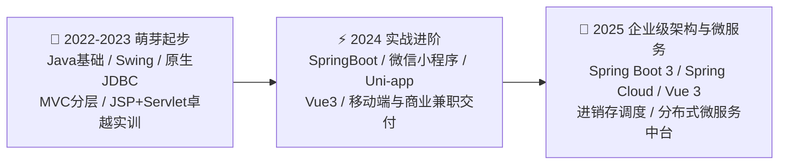

# 🚀 从零开始的编程之旅 (My Programming Journey)

> “不积跬步，无以至千里；不积小流，无以成江海。”  
> 本仓库真实记录了我从**零基础编程起步**，到**Web全栈与商业实战**，再到**分布式微服务架构**的完整技术演进与项目沉淀历程。

---

## 🗺️ 技术演进全景图 (Roadmap)

---

## 📚 项目归档索引 (Project Archive)

### 阶段一：🌱 萌芽与基础课设 (2022 - 2023)
> 扎实基础语法、面向对象设计思想，跑通单机桌面客户端与经典 MVC Web 架构。

| 序号 | 项目名称 | 核心技术栈 | 研发与归档时间 | 简介说明 | 项目链接 |
| :---: | :--- | :--- | :---: | :--- | :---: |
| 01 | **🍅 番茄影院售票系统** | `Java Swing` · `JDBC` · `MySQL` | **2023 年 06 月** | 包含前台选座购票与后台排片运营的完整电影院桌面系统 | [查看详情](./01-萌芽与基础课设%20(2023)/2023-06-番茄影院售票系统/) |
| 02 | **🏥 医院预约挂号系统** | `JSP` · `Servlet` · `JavaBean` · `JDBC` | **2023 年 11 月** | 卓越工程师实训组长主导项目，包含全流程立项设计文档与排班挂号 | [查看详情](./01-萌芽与基础课设%20(2023)/2023-11-医院预约挂号系统/) |

---

### 阶段二：⚡ 实战进阶与小程序 (2024)
> 迈入 Web 时代，掌握前后端分离、RESTful API 设计，完成多套商业与兼职全栈项目交付。

| 序号 | 项目名称 | 核心技术栈 | 研发与归档时间 | 简介说明 | 项目链接 |
| :---: | :--- | :--- | :---: | :--- | :---: |
| 03 | **🧓 社区养老志愿者微信小程序** | `SpringBoot` · `Uni-app` · `Vue3` · `微信小程序` | **2024 年 03 月** | 面向社区老人呼叫求助与青年志愿帮扶的闭环平台 | [查看详情](./02-实战进阶与小程序%20(2024)/2024-03-社区养老志愿者微信小程序/) |
| 04 | **🍵 茶文化主题 APP 与管理中台** | `SpringBoot` · `Vue3` · `Uni-app` · `MyBatis-Plus` | **2024 年 06 月** | 茶文化知识科普、茶品在线商城与茶友互动社区全栈系统 | [查看详情](./02-实战进阶与小程序%20(2024)/2024-06-茶文化主题APP与管理中台/) |
| 05 | **🐱 宠物管理与社交分享系统** | `SpringBoot` · `Vue3` · `Redis` | **2024 年 10 月** | 宠物档案、健康记录与社交动态分享平台 | [查看详情](./02-实战进阶与小程序%20(2024)/) |

---

### 阶段三：🏢 企业级系统与微服务实战 (2025)
> 深入企业级解决方案，掌握中后台权限体系、分布式微服务拆分、Nacos 服务治理、SpringBoot 3 全栈落地。

| 序号 | 项目名称 | 核心技术栈 | 研发与归档时间 | 简介说明 | 项目链接 |
| :---: | :--- | :--- | :---: | :--- | :---: |
| 06 | **🎮 基于 SpringCloud 的分布式游戏商城** | `SpringCloud` · `Nacos` · `OpenFeign` · `MyBatis-Plus` | **2025 年 06 月** | 分布式多模块游戏周边与商城系统，含前台聚合与业务中台 | [查看详情](./03-企业级架构与微服务%20(2025)/2025-基于SpringCloud的游戏商城/) |
| 07 | **💧 桶装水配送管理系统** | `SpringBoot 3` · `Vue 3` · `Element-Plus` · `H5移动端` | **2025 年 09 月** | 企业级进销存、工单调度、空桶回流与配送员 H5 全栈闭环 | [查看详情](./03-企业级架构与微服务%20(2025)/2025-09-桶装水配送管理系统/) |

---

## 📌 项目整理原则与准则

1. **真实记录**：每一个阶段的项目均保留最初的代码风格与演进记录，不粉饰历史，只展现真实成长。
2. **规范工程化**：每个项目均剔除编译缓存、临时日志，提供完整的环境说明与启动文档。
3. **安全合规**：所有收录项目均完成敏感信息脱敏（包括个人私钥、商业账号密码、真实生产配置等）。

---

## 👨‍💻 关于作者
* **GitHub**: [@2454435987](https://github.com/2454435987)
* **邮箱**: `2454435987@qq.com`
